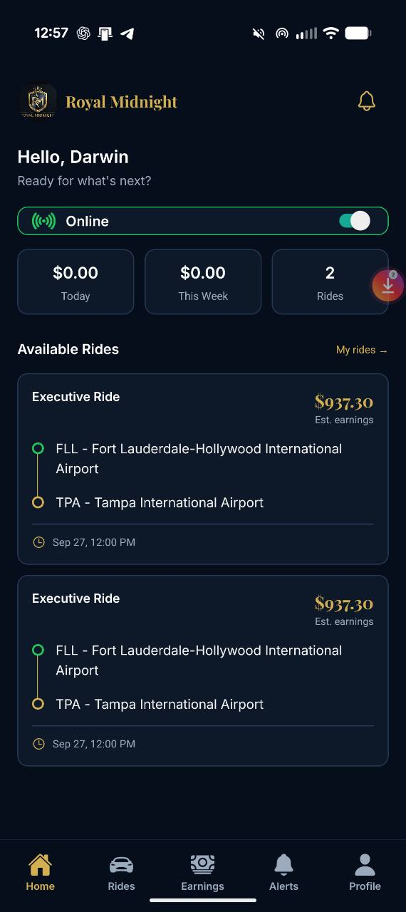
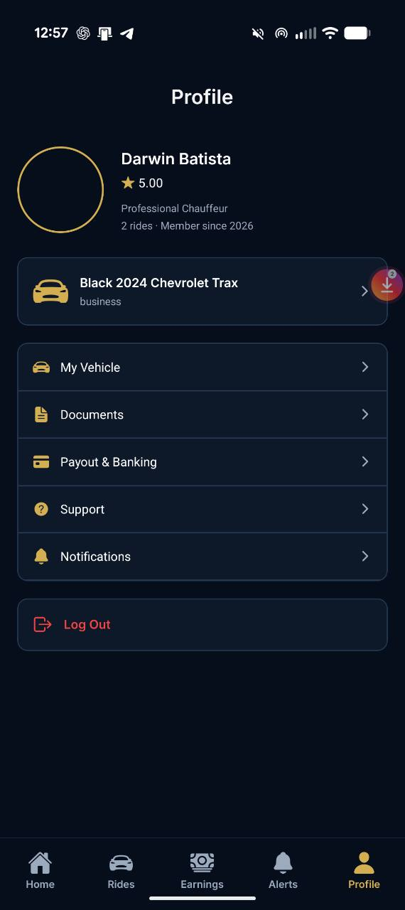
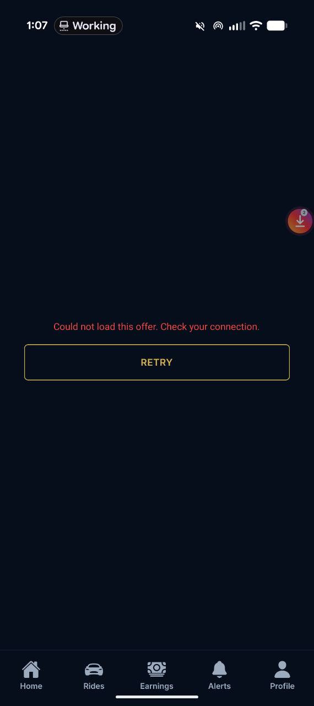
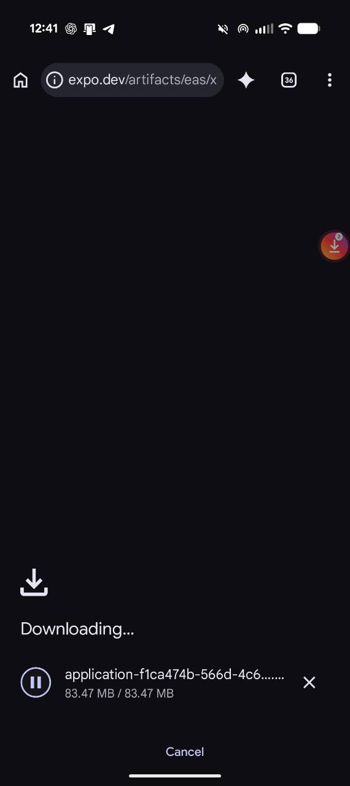
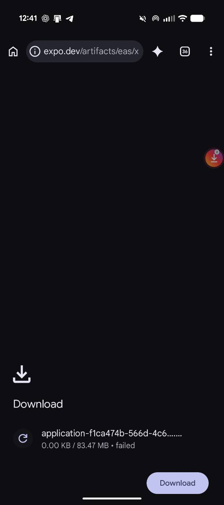
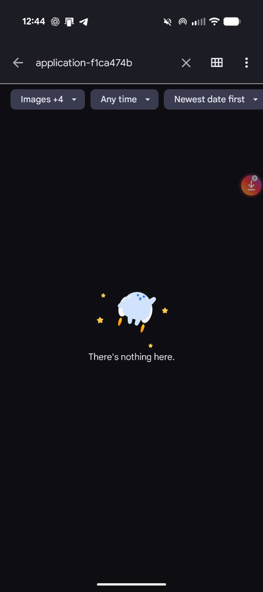
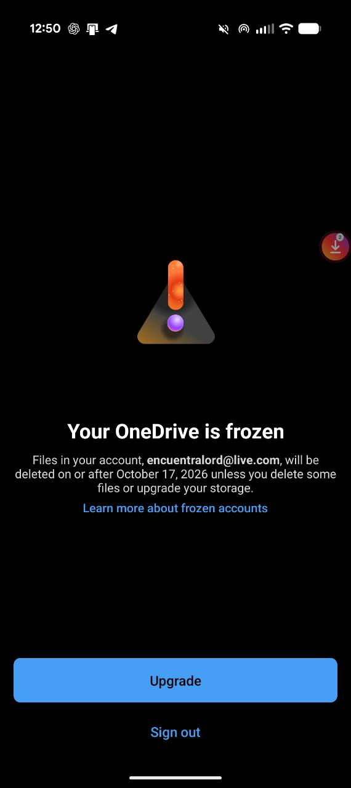
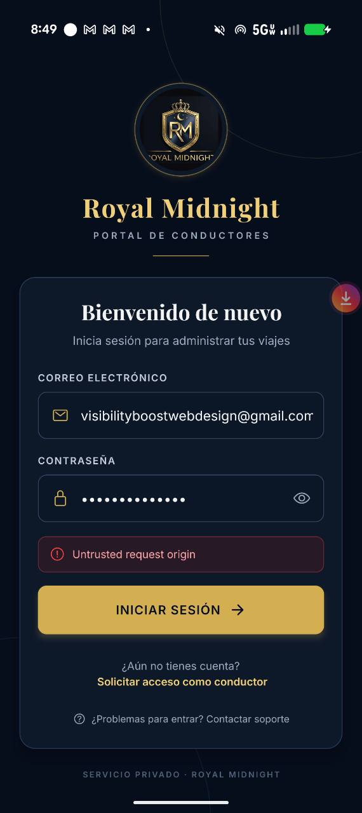

# Royal Midnight Driver — verificación real del build 23

| Campo | Valor |
| --- | --- |
| **Fecha** | 27 de septiembre de 2026 |
| **Plataforma** | Android; teléfono físico del usuario |
| **APK** | Royal-Midnight-Driver-v2.0.0-build23.apk |
| **Versión** | 2.0.0 / versionCode 23 |
| **SHA-256** | 9C4573DDA3A60BF9819DB4112E9E6846E30C90C13209892E65868672C0AC8A90 |
| **Alcance** | Instalación/actualización, comparación visual y flujos reales |

## Estado

- APK local y hash confirmados de nuevo.
- El usuario informó que Android no le permite instalar el APK descargado desde el enlace estable.
- El 27 de septiembre se comprobó el enlace siguiendo sus redirecciones: respondió HTTP 200, `application/octet-stream`, `Content-Disposition` de APK y `Content-Length: 83467752`, idéntico al archivo local verificado.
- Dos capturas del teléfono muestran que Chrome llega a `83.47 MB / 83.47 MB`, permanece en `Downloading...` y después cambia a `0.00 KB / 83.47 MB · failed`. El instalador de Android no llegó a abrirse.
- Pendiente: comprobar en la app Archivos si existe un `.apk` completo en Descargas o solo un temporal; la evidencia actual localiza el fallo en la finalización de la descarga de Chrome, no en firma/paquete.
- No hay resultados de UI o funcionalidad atribuidos al build 23 todavía.

## Resumen de hallazgos

| Severidad | Cantidad |
| --- | ---: |
| Crítica | 0 |
| Alta | 4 |
| Media | 0 |
| Baja | 2 |
| **Total** | **6** |

## Matriz de verificación

| Área | Estado | Evidencia / notas |
| --- | --- | --- |
| Instalación o actualización sobre la versión anterior | Pendiente | No desinstalar primero; conservar sesión y datos |
| Login, sesión persistida, logout, teclado y contraseña | Pendiente | No heredar automáticamente el resultado del build 22 |
| Home | Pendiente | Comparar con `driver-app-screens/01-home.png` |
| Rides: filtros, búsqueda, refresh y detalle | Pendiente | Comparar con `driver-app-screens/04-my-rides.png` |
| Earnings y Payout & Banking | Pendiente | Comparar con `driver-app-screens/05-earnings.png` |
| Alerts y navegación a destinos | Pendiente | Comparar con `driver-app-screens/06-alerts.png` |
| Profile, Vehicle, Documents y Support | Pendiente | Comparar con `driver-app-screens/07-profile.png` |
| Offer | Pendiente | Solo con reserva de prueba identificada |
| Active Trip | Pendiente | Solo con reserva de prueba identificada; no operar viajes reales |
| Ubicación, permisos, notificaciones y FCM | Pendiente | Registrar explícitamente lo que no pueda probarse |
| Safe areas, contraste, fuentes, tarjetas, tabs y scroll | Pendiente | Revisar en cada pantalla capturada |
| Estados loading, vacío, error, sin red y retorno desde segundo plano | Pendiente | Capturar cada fallo reproducible |

## Hallazgos

Cada problema observado se añadirá aquí con severidad, categoría, ruta, pasos exactos y evidencia. Los fallos estáticos requieren captura; los interactivos, secuencia de capturas y vídeo cuando sea posible.

### ISSUE-001: el mismo viaje aparece dos veces

| Campo | Valor |
| --- | --- |
| **Severidad** | Alta |
| **Categoría** | Funcional / integridad de datos |
| **Pantalla** | Home; también debe revisarse Rides |
| **Estado** | Confirmado visualmente en build23 |

Home muestra `2 Rides` y dos tarjetas idénticas para una sola reserva de prueba: mismo tipo, origen, destino, fecha/hora y ganancia estimada. El usuario confirmó que la web muestra correctamente una sola reserva, por lo que el defecto observable está limitado actualmente al cliente móvil o a la forma en que consume/combina los datos.

**Criterio de aceptación:** una reserva se representa una sola vez por identificador estable en Home, Rides, Alerts y ofertas, incluso después de refresh, polling, reconexión, foreground/background y eventos repetidos. El contador debe usar el mismo conjunto único.

### ISSUE-002: no llegó aviso de una nueva reserva de prueba

| Campo | Valor |
| --- | --- |
| **Severidad** | Alta |
| **Categoría** | Funcional / notificaciones / permisos |
| **Pantalla** | Sistema Android, Alerts y Home |
| **Estado** | Informado por el usuario; requiere reproducción controlada |

Se creó una reserva de prueba elegible y no se observó notificación. Antes de atribuir causa deben registrarse: permiso Android, token/registro FCM, app en foreground/background/cerrada, estado Online y presencia o ausencia del evento en Alerts.

**Criterio de aceptación:** una reserva nueva elegible produce exactamente un aviso oportuno; en foreground existe señal dentro de la app y actualización de datos, y en background/cerrada llega la notificación del sistema. Pulsarla abre la reserva correcta y no crea duplicados.

### ISSUE-003: `WELCOME20` permite reutilización por un cliente antiguo

| Campo | Valor |
| --- | --- |
| **Severidad** | Alta |
| **Categoría** | Regla de negocio / promociones |
| **Superficie** | Flujo de reserva/API compartido; no exclusivo de Driver |
| **Estado** | Informado por el usuario; requiere caso controlado y auditoría del registro de redención |

Un cliente que ya había utilizado `WELCOME20` pudo aplicarlo de nuevo. El límite esperado es una utilización total por usuario, incluidos usuarios y redenciones históricas.

**Criterio de aceptación:** la API rechaza una segunda redención del mismo usuario de forma atómica, también con solicitudes concurrentes, sesiones/dispositivos distintos y cuentas antiguas; la UI presenta un mensaje claro y no confirma un precio descontado inválido.

### ISSUE-004: falta representación de avatar

| Campo | Valor |
| --- | --- |
| **Severidad** | Baja |
| **Categoría** | Visual / UX |
| **Pantalla** | Profile |
| **Estado** | Confirmado visualmente en build23 |

El círculo de avatar aparece vacío. Si no existe foto, debe mostrarse un fallback intencional, por ejemplo iniciales o logo, conservando contraste.

### ISSUE-005: categoría del vehículo en minúsculas

| Campo | Valor |
| --- | --- |
| **Severidad** | Baja |
| **Categoría** | Contenido / consistencia visual |
| **Pantalla** | Profile |
| **Estado** | Confirmado visualmente en build23 |

La categoría aparece como `business`; debe presentarse con capitalización legible y coherente con el resto de la app, sin alterar el valor persistido.

### ISSUE-006: el detalle de una oferta visible no carga

| Campo | Valor |
| --- | --- |
| **Severidad** | Alta |
| **Categoría** | Funcional / navegación / manejo de errores |
| **Pantalla** | Offer detail |
| **Estado** | Confirmado visualmente en build23 |

Desde Home, al pulsar una oferta disponible, la pantalla de detalle queda vacía y muestra `Could not load this offer. Check your connection.` con botón `RETRY`. El usuario indica que la versión web sí presenta la información esperada.

La causa aún no está diagnosticada. Deben comprobarse de forma controlada el identificador enviado por la tarjeta, la ruta móvil, autorización, respuesta del endpoint, esquema de datos y relación con la duplicación de la misma reserva. No asumir que es una caída de red porque el texto sea genérico.

**Criterio de aceptación:** cada oferta única abre su detalle correcto con la misma información autorizada disponible en web, permite volver y reintentar, y diferencia claramente errores de red, reserva inexistente, expirada o no autorizada.

## Regla económica obligatoria para cupones

- El descuento se aplica al subtotal elegible antes de impuestos y demás cargos.
- La ganancia del conductor no disminuye por el cupón: se calcula usando el importe/base anterior al descuento conforme a la regla normal de reparto.
- La compañía absorbe el descuento en su porción; el remanente de la compañía se calcula después de preservar la ganancia del conductor y contabilizar impuestos/cargos según su naturaleza.
- Redondeo, moneda y desglose deben ser idénticos entre cotización, checkout, reserva persistida, panel web, Driver, recibos y liquidación.
- La corrección futura debe incluir pruebas con y sin cupón, redención válida/inválida, impuestos, cargos, redondeo y reembolso/cancelación. No se considera verificada solo porque la tarjeta móvil muestre una cifra.

## Revisión completa pendiente — sin cambios de código en esta sesión

1. Instalación/actualización, versión, arranque, login, sesión persistida, logout, teclado y recuperación tras reinicio.
2. Home: estado Online, refresh, contador y unicidad por reserva, viaje activo, loading/vacío/error/sin red.
3. Rides: filtros, búsqueda, orden, refresh, navegación, estados y deduplicación cruzada con Home/Alerts.
4. Offer: aviso, temporizador, datos, necesidades, vehículo, aceptar/rechazar, doble pulsación, expiración y conflicto entre conductores.
5. Active Trip: checklist y transiciones on-way/arrived/start/complete/cancel, errores, reintentos y concurrencia; solo con reserva de prueba.
6. Earnings/Payout: período, totales, viaje individual, cupón, impuestos, cargos, redondeo, liquidación y consistencia con backend.
7. Alerts: llegada en foreground/background/cerrada, permiso denegado/aceptado, lectura, destino, persistencia y ausencia de duplicados.
8. Profile y subpantallas: avatar, vehículo, documentos, banca, soporte, notificaciones, regreso y logout.
9. Ubicación: permisos aproximado/preciso, denegado, solo durante uso, background, pérdida de señal y consumo razonable.
10. Ciclo Android: rotación si aplica, background/foreground, modo ahorro, red intermitente, proceso terminado y actualización sobre versión anterior.
11. Accesibilidad y presentación: safe areas, texto grande, contraste, labels, foco, touch targets, scroll, teclado y lectores de pantalla.
12. Rendimiento/diagnóstico: arranque, transiciones, listas, uso sostenido, errores no controlados y logs vinculados a reproducciones.
13. Promociones compartidas: límite por usuario histórico, atomicidad, autorización server-side, auditoría y consistencia web/móvil.

No se leyó ni modificó código de producto para esta revisión. Los riesgos no observados directamente permanecen como casos pendientes, no como defectos confirmados.

## Remediación posterior al build 23 — pendiente de publicación y teléfono

El 28 de septiembre se completó una corrección agrupada a partir de los hallazgos reales. Este bloque registra implementación y verificación local; **no aprueba todavía el build 24**, que aún no existe, ni sustituye la prueba en el teléfono.

| Hallazgo | Corrección implementada | Verificación local |
| --- | --- | --- |
| ISSUE-001, viaje duplicado | Home y Offer consumen una sola consulta canónica del pool; deduplicación defensiva por ID | Pruebas de pool único y selección de oferta pasan |
| ISSUE-006, detalle no carga | Offer obtiene el viaje del mismo pool autorizado y distingue conexión de oferta expirada/tomada | Prueba de selección del pool y typecheck pasan |
| ISSUE-002, sin push | El servidor acepta tokens modernos `ExpoPushToken[...]`; registro se refresca al abrir/volver a foreground; taps fríos y activos navegan según tipo | Pruebas de token y rutas de notificación pasan |
| ISSUE-003, WELCOME20 repetible | Recuento por cliente incluye usos históricos/cancelados y migración idempotente fija el límite a uno | Pruebas de política pasan; migración aún no publicada |
| Regla económica | Cupón sobre subtotal elegible antes de impuestos/cargo de tarjeta; tarifa aeroportuaria no se pierde; comisión del conductor conserva la base previa al cupón | Pruebas de precios, incluida tarifa no descontable, pasan |
| ISSUE-004/005 | Iniciales como avatar y etiqueta legible de clase del vehículo | Pruebas de presentación pasan |

Hallazgos adicionales del full scan corregidos:

- Total de viaje completado usa ganancia del conductor más propina, nunca el precio pagado por el pasajero.
- Una caída de red al iniciar ya no elimina una sesión guardada; solo 401/403 la descartan.
- Respuestas de soporte del conductor se persisten con rol `driver`, no `passenger`.
- Documentos y Vehículos ya no anidan dos listas verticales, evitando scroll roto y advertencias nativas.
- La apertura fue sustituida por una presentación navy/dorada con logo grande, hotel y tres vehículos negros (sedán, SUV grande y crossover), explícitamente sin Mercedes Sprinter. Evidencia: `../driver-reliability-prebuild-evidence/launch-screen-phone-preview.png`.

Verificación integrada acumulada:

- App Driver: 13/13 pruebas; typecheck sin errores.
- Servidor: 35/35 pruebas enfocadas.
- Expo Doctor: 21/21 después de alinear ocho parches compatibles del SDK 57.
- Auditoría de dependencias de producción: sin vulnerabilidades altas/críticas; quedan avisos moderados transitivos cuya corrección automática exigiría versiones incompatibles.
- Export Android/Hermes: correcto, 2.178 módulos y los nuevos recursos incluidos.
- Sincronización repo → staging: 64 archivos comprobados, cero diferencias de hash.
- `git diff --check`: correcto.

Bloqueo actual: el despliegue de producción fue rechazado por la protección de aprobación porque publicaría conjuntamente servidor, web y una migración de base de datos. Se necesita autorización explícita del usuario. Hasta entonces no se crea build 24: hacerlo apuntaría a un servidor que todavía no contiene las correcciones de push/cupones/precios.

### DELIVERY-001: Chrome no finaliza la descarga del APK

| Campo | Valor |
| --- | --- |
| **Clasificación** | Bloqueo externo de entrega; todavía no es un fallo comprobado de la app |
| **Superficie** | Chrome para Android / gestor de descargas |
| **Estado** | Investigación; pendiente de revisar Descargas en la app Archivos |

**Evidencia**

1. Chrome muestra la transferencia completa, pero sigue en estado `Downloading...`.
   
2. Después, la misma descarga aparece como `failed` y `0.00 KB / 83.47 MB`.
   

El enlace fue comprobado independientemente y entrega83.467.752 bytes, por lo que no se atribuye el fallo a un enlace caído. No se ha probado todavía si Chrome dejó un archivo completo utilizable en `Descargas`.

3. La primera búsqueda en Archivos no prueba ausencia del APK: aparece el filtro de tipo `Images +4`, que puede excluir archivos `.apk`.
   

Próximo paso: borrar la búsqueda y abrir `Descargas` desde la navegación de Archivos sin aplicar filtros. Solo si allí tampoco aparece el APK se considerará que Chrome eliminó el temporal al fallar.

4. El usuario confirmó que el APK no aparece en Descargas. Se abandona el reintento por el mismo enlace de Chrome.

**Ruta alternativa preparada**

Se creó una copia con nombre corto en `C:\Users\encue\OneDrive\Escritorio\Hermes\Royal-Midnight-Driver-build23.apk`. Tamaño verificado:83.467.752 bytes. SHA-256 verificado: `9C4573DDA3A60BF9819DB4112E9E6846E30C90C13209892E65868672C0AC8A90`. El proceso de OneDrive está activo en el PC, pero la disponibilidad en la nube/teléfono debe confirmarse en la app OneDrive antes de atribuir éxito a esta vía.

5. La app móvil de OneDrive confirmó que la cuenta está congelada por falta de espacio; la copia local anterior no podía servir como transferencia.
   

6. Por petición del usuario, el APK verificado se subió mediante la conexión existente de Google Drive. La lectura posterior de `Mi unidad` confirmó:
   - ID: `1-1GtEMUcG6YzJu5tdY_tBOXlnOdZGujc`
   - Nombre: `Royal-Midnight-Driver-build23.apk`
   - MIME: `application/vnd.android.package-archive`
   - Tamaño:83.467.752 bytes
   - Descarga habilitada; archivo privado/no compartido públicamente.
   - URL verificada: `https://drive.google.com/file/d/1-1GtEMUcG6YzJu5tdY_tBOXlnOdZGujc/view?usp=drivesdk`

Pendiente: descargar/abrir el APK desde Google Drive en el teléfono y observar el primer resultado del instalador Android.

## Publicación de la remediación antes del build 24

El usuario autorizó expresamente el despliegue productivo el 28 de septiembre. La remediación de servidor/web y la migración idempotente de `WELCOME20` quedaron publicadas antes de crear el APK24, evitando que la aplicación nueva apuntara a un backend antiguo.

- Deployment: `dpl_HrLejxbZ6kZgX65GMHHmyQ7U2U4Q` (`READY`).
- Alias: `https://www.royalmidnight.com`.
- Migración aplicada: `20260927123000_welcome20_once_per_customer.sql`.
- Health productivo: `status: ok`, revisión `aa9add8aca6e2e86671860a442b4d8cb636852ed`.
- `/book`: respuesta correcta.
- `WELCOME20` sin sesión: rechazo correcto por límite por cliente.
- Logs productivos de nivel error posteriores al despliegue: ninguno encontrado.

Esto verifica la publicación técnica, no las funciones reales del Driver. Continúan pendientes el APK24 y toda la matriz en el teléfono.

## Build 24 disponible para validación real

EAS terminó el build Android `da62c741-4d17-497d-b498-fe8c8eebe734`, `versionCode 24`, sin crear duplicados.

| Campo | Valor |
| --- | --- |
| Archivo local | `artifacts/driver-app-v2/dist-android/Royal-Midnight-Driver-v2.0.0-build24.apk` |
| Tamaño | 88.091.860 bytes |
| SHA-256 | `AD5CB396B8341664A8F1AD2A59106C1A4CC14A4714A4B0C4CEAA25B283880804` |
| Estructura | `AndroidManifest.xml` y `assets/index.android.bundle` presentes; 1.390 entradas |
| Google Drive ID | `1QzGLDDBfaNggUunLs6Y68SsWTAMCoKql` |
| Google Drive | `https://drive.google.com/file/d/1QzGLDDBfaNggUunLs6Y68SsWTAMCoKql/view?usp=drivesdk` |
| Lectura posterior de Drive | nombre, MIME y tamaño coinciden; descarga habilitada; archivo privado |

Pendiente de evidencia en teléfono: instalar/actualizar sin borrar datos y comprobar portada nueva, viaje único y contador, detalle de oferta, notificación con app en segundo plano/cerrada, avatar/clase, límite histórico de `WELCOME20`, ganancia del conductor/parte de compañía e interacción completa de pestañas, scroll y ciclo de viaje. El build no se considera aprobado hasta completar esas pruebas.

## REGRESSION-WEB-001: `/book` cae en el error global después del despliegue

| Campo | Valor |
| --- | --- |
| Severidad | Crítica para nuevas reservas web |
| Superficie | Web productiva; no atribuida al APK24 |
| Estado | Causa raíz confirmada; corrección local verificada; despliegue pendiente de autorización |

El navegador productivo registró `No QueryClient set`. La web y los hooks compartidos estaban empaquetando instancias distintas de React Query debido a la mezcla de React 19.1.0 y 19.2.3 dentro del monorepo. Se añadió `@tanstack/react-query` a la deduplicación de Vite y una prueba contractual que falla si vuelve a omitirse.

En un entorno web limpio, las pruebas pasaron 3/3, el typecheck pasó y `/book` renderizó completamente en móvil con API simulada segura, sin el error original. También se recorrieron las rutas públicas principales sin error boundary. La corrección quedó publicada en `dpl_9Tdi36VDnPETFr5F1o4q8JpNWoed`; `/book` renderizó completo en producción y no produjo errores de consola. Este arreglo no requiere otro APK.

## ISSUE-007: login del build24 rechazado por protección de origen

| Campo | Valor |
| --- | --- |
| Severidad | Crítica: bloquea acceso al Driver |
| Pantalla | Login, build24 |
| Estado | Corrección publicada y sondas productivas PASS; pendiente de reintento real en teléfono |

La app envía correctamente `X-RM-Client: driver-app`, pero Android conservó la cookie HttpOnly emitida por el servidor. Esa cookie hacía que el middleware aplicara la validación CSRF de navegador y rechazara el origen nativo antes de validar credenciales. Por eso la misma cuenta funciona en el portal web.

La corrección reconoce únicamente el identificador nativo exacto ya usado por el contrato de autenticación. Pruebas: cliente nativo con cookie retenida permitido; origen web externo con cookie rechazado; web oficial permitida; suites CSRF/auth response 6/6 PASS. No requiere build25: build24 ya envía el encabezado.

Publicada en producción y reconfirmada después del deployment final `dpl_At9iQXjqEkyySQK4aEVwHS6ZCVvY`: la sonda equivalente al Driver con cookie retenida llegó a validación del login y devolvió HTTP 400 por cuerpo vacío, mientras un origen web externo permaneció bloqueado con HTTP 403. `/api/healthz` respondió `ok`. Esto confirma la ruta del servidor, no el acceso con credenciales reales; falta que el usuario reintente en el mismo teléfono.

## REGRESSION-WEB-002: advertencias React #418 de hidratación

La advertencia observada inicialmente en Login/Signup quedó resuelta haciendo que solo se hidrate HTML cuyo marcador prerenderizado coincide con la URL; el fallback de Vercel para rutas SPA se limpia y monta como cliente. FAQ continuó fallando aun después de sustituir Radix, y la comparación con páginas de servicios demostró que la causa común eran los scripts JSON-LD extraídos del árbol SSR.

El JSON-LD ahora permanece dentro del árbol renderizado, posición válida para datos estructurados, mientras Helmet conserva `title/meta/link` en `<head>`. Contrato rojo/verde 1/1 PASS. Deployment final `dpl_At9iQXjqEkyySQK4aEVwHS6ZCVvY`: FAQ, Airport Transfers, Book, Login y Signup renderizan en sesiones nuevas con cero errores de consola; FAQ muestra las 10 preguntas y conserva datos estructurados. No exige APK nuevo.
